<p align="center"></p>

<h1 align="center">Coffee Explorer</h1>

<p align="center"><b>CFF Explorer, rebuilt for modern Windows</b></p>

[](https://github.com/iArtorias/coffee_explorer/releases)

> The familiar PE editor, redesigned with a Visual Studio aesthetic, high DPI support, universal undo and redo, Authenticode verification, PDB symbols resolution, Detect It Easy integration, and multilanguage support.

**Coffee Explorer** is a from scratch recreation of **[CFF Explorer](https://ntcore.com/explorer-suite/)**. It keeps the familiar layout: a tree of the file on the left, the selected structure on the right, editable cells, and the same tools (*Address Converter*, *Dependency Walker*, *Hex Editor*, *Import Adder*, *Rebuilder*, *Resource Editor*).

Engineered entirely from the ground up without legacy code, the project features a high performance C++23 core (`pecore.dll`) powered by [PeLib](https://github.com/iArtorias/pelib-updated), paired with a responsive WPF interface styled after Visual Studio Code.

> [!IMPORTANT]
> Coffee Explorer edits files in memory. Nothing touches the disk until you **Save**, and every change can be undone, structural ones included (adding sections, rebuilding imports, removing a signature).

> [!NOTE]
> Some legacy features of CFF Explorer are deliberately gone: the scripting engine, PEiD signatures, plugins, *Multiple Interface* mode, binding imports. See [What was removed](#what-was-removed).

---

## Contents

- [Screenshots](#screenshots)
- [Overview](#overview)
- [Features](#features)
- [Languages](#languages)
- [Custom themes](#custom-themes)
- [What was removed](#what-was-removed)
- [Requirements](#requirements)
- [Installation](#installation)
- [Configuration](#configuration)
- [Troubleshooting](#troubleshooting)
- [Building](#building)
- [Credits](#credits)

---

## Screenshots

| | |
|:---:|:---:|
| 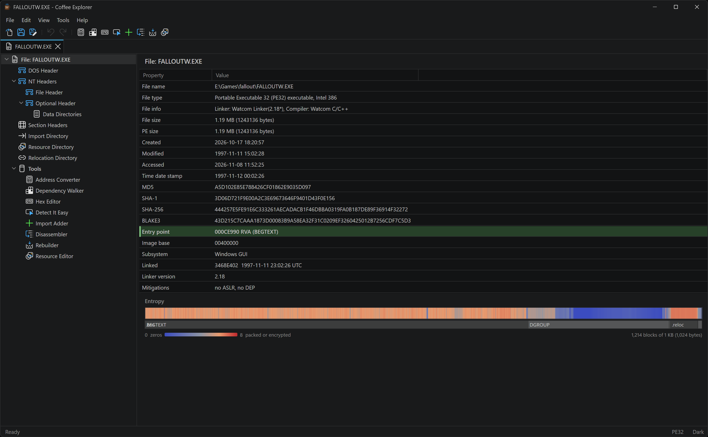 | 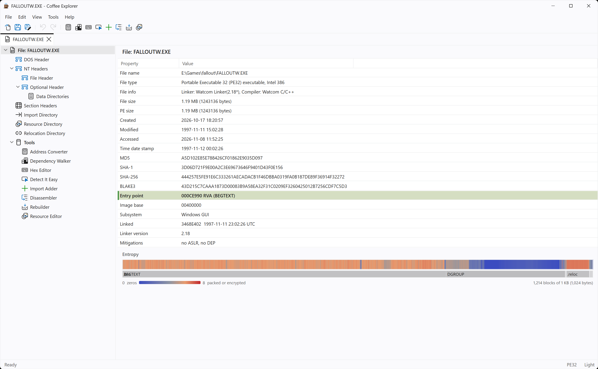 |
| *File overview with the entropy map, dark theme* | *File overview with the entropy map, light theme* |
| 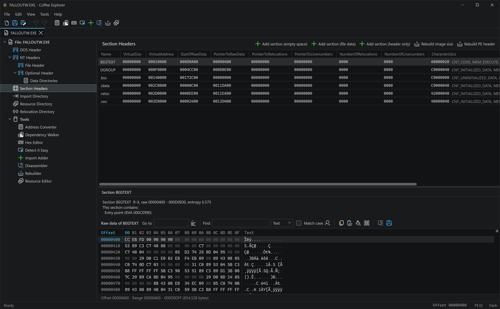 | 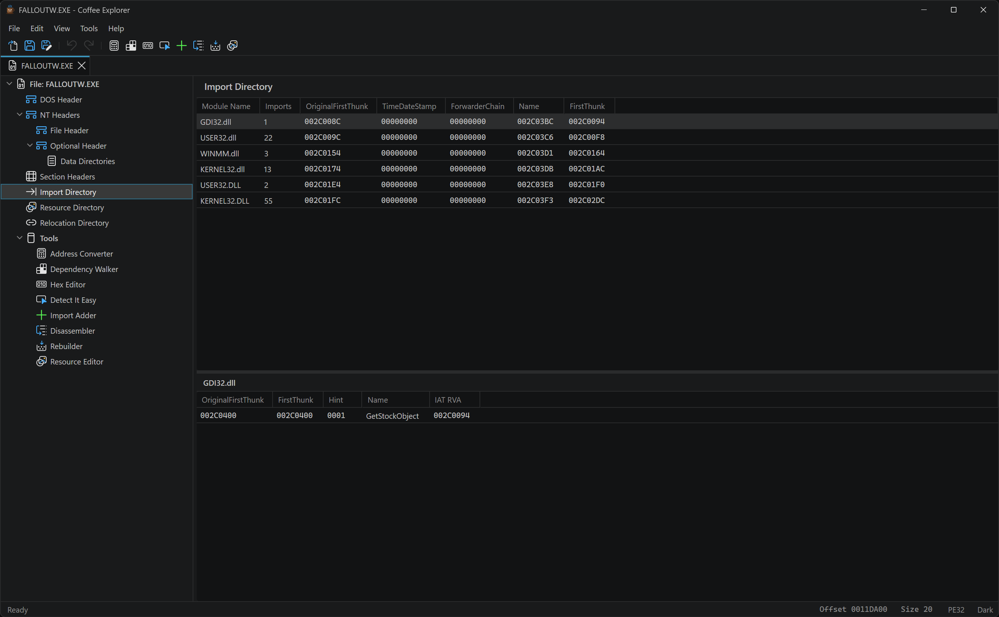 |
| *Section headers* | *Import directory with the import names* |
| 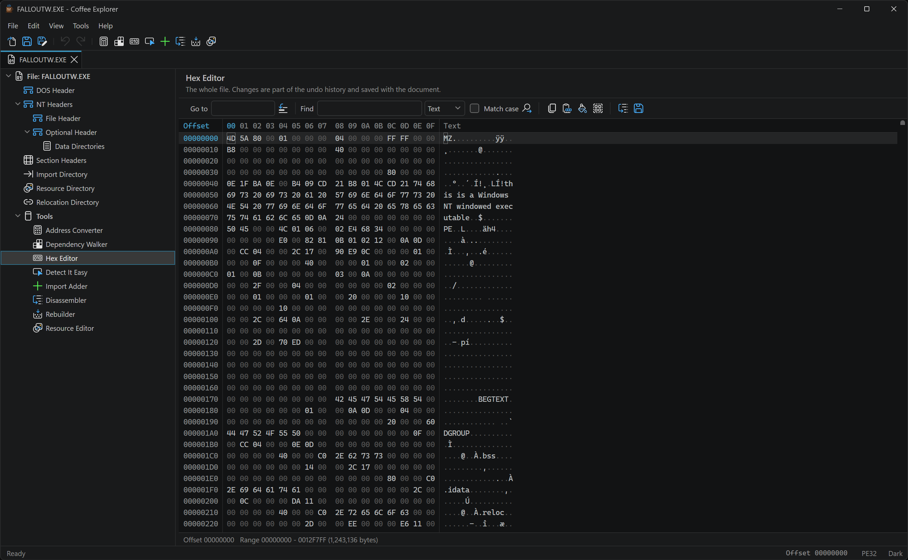 | 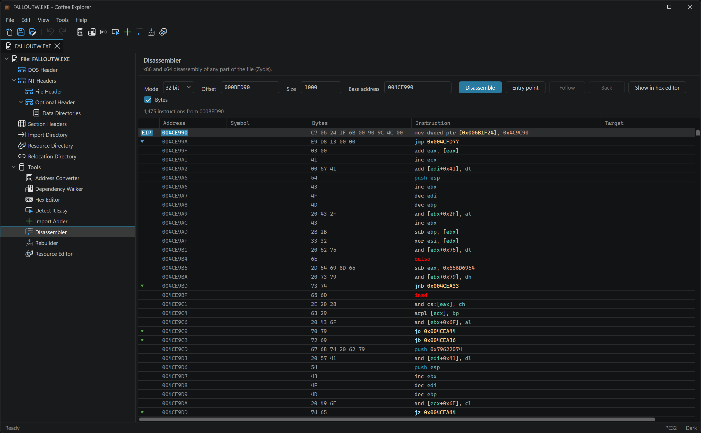 |
| *Hex editor* | *Disassembler* |
| 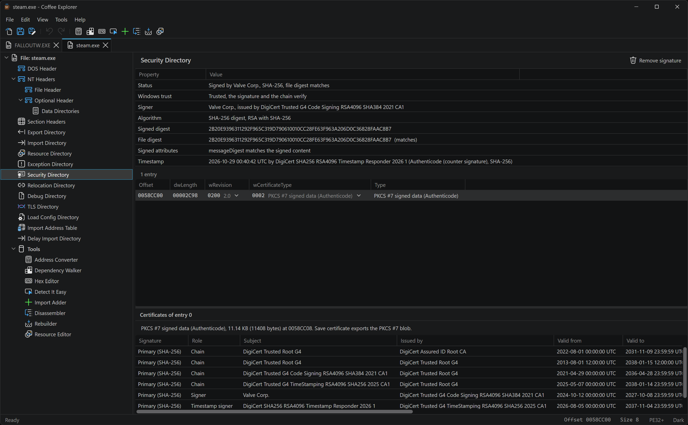 | 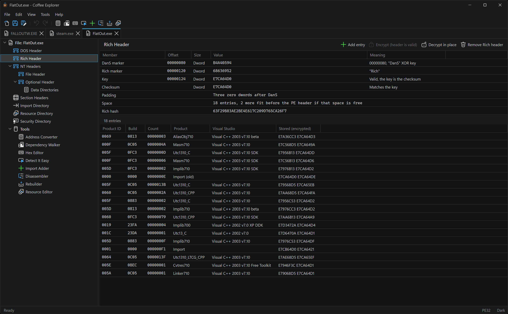 |
| *Authenticode signatures and Windows trust* | *Rich header* |
| 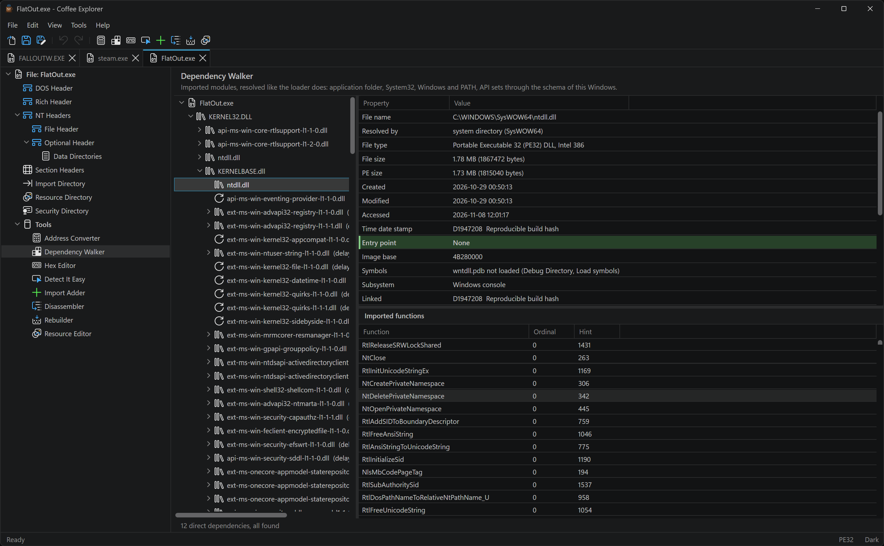 | 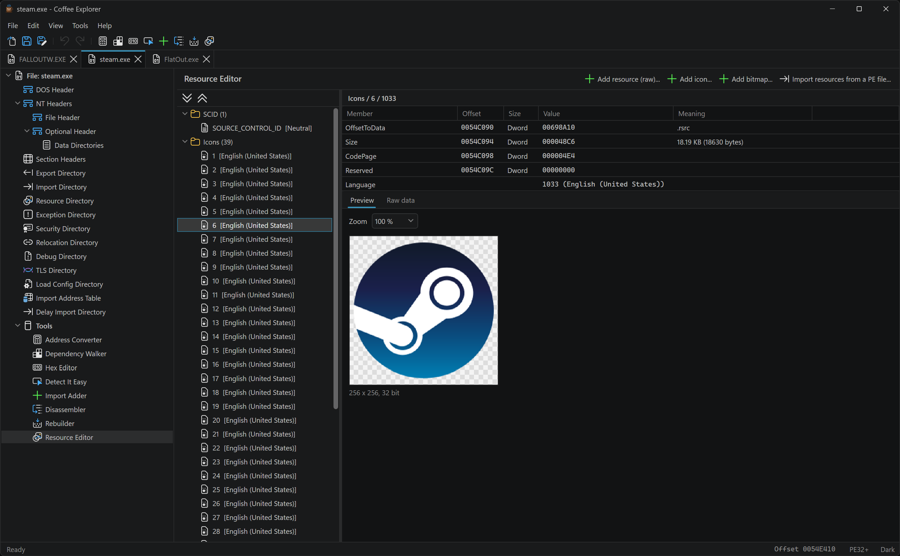 |
| *Dependency Walker with API set resolution* | *Resource Editor with icon preview* |
| 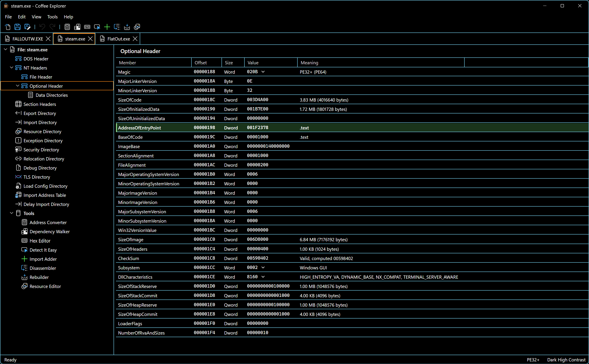 | 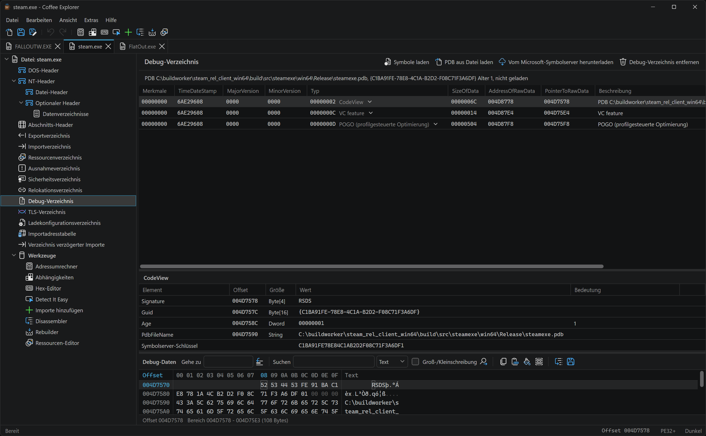 |
| *VS Code Dark High Contrast as a custom theme* | *The interface in German* |

---

## Overview

CFF Explorer is still the tool many people reach for when they need to look inside a PE file. However, it has not changed since 2012:

- It is a fixed 96 DPI window with no dark mode.
- It has no undo.
- The x64 exception directory shows up empty.
- It reads only the first debug entry.
- It has no Authenticode view, no Rich header and no overlay.
- Its file identification relies on a PEiD database that is outdated.

Coffee Explorer keeps the workflow and fixes the rest:

| Area | CFF Explorer VIII | Coffee Explorer |
|---|---|---|
| Look | Win32 controls, 96 DPI, light only | Visual Studio Code light and dark that follow the Windows theme **live**, **custom VS Code themes**, per monitor DPI v2, vector icons |
| Language | English only | **English, German and Russian**, more with a single text file |
| Editing | Direct writes, no undo | **Undo and redo for every edit**, structural operations included, modified marker per tab |
| File identification | PEiD database from 2012 | **Detect It Easy** with the current DiE database |
| Hashes | MD5, SHA-1 | MD5, SHA-1, SHA-256, **BLAKE3**, computed in parallel (hardware SHA on Windows) |
| Signatures | Security directory as raw bytes | **Authenticode verification**: digest check, certificates, timestamps, nested signatures, Windows trust |
| Symbols | None | **PDB symbols** in the disassembler, exception directory and address converter, Microsoft symbol server download |
| Exception directory | IA64 layout, empty for x64 files | x64 `RUNTIME_FUNCTION` with decoded `UNWIND_INFO`, ARM64 packed unwind data, function names |
| Debug directory | First entry only | All entries: CodeView (RSDS or NB10), POGO, VC feature, repro, extended DLL characteristics (CET), and removal of the whole directory |
| Rich header | Not shown | Decoded, editable, encrypt and decrypt, checksum validation, product names |
| Large files | Slow, the window might freeze | Fast loading, background parsing, a 300 MB game executable opens in about a second |
| Undecorated names | Bottom panel | **Undecorated name** column in exports and imports |

---

## Features

### Interface

| Feature | What it does |
|---|---|
| **Visual Studio Code theme** | Light and dark palettes generated from the VS Code theme files. *Use system setting* switches live when Windows changes its theme. |
| **Custom VS Code themes** | Any VS Code color theme dropped into the `themes` folder appears next to Light and Dark, high contrast themes included. See [Custom themes](#custom-themes). |
| **Interface languages** | English, German and Russian, switched live in the options. See [Languages](#languages). |
| **High DPI** | Per monitor DPI v2: crisp text and icons on 4K screens and when moving windows between monitors. |
| **VS Image Library icons** | Every icon comes from the Visual Studio 2026 Image Library as a vector drawing, recolored for each theme. |
| **Document tabs** | One tab per file, each with its own tree. Opening a file that is already open simply activates its tab (CFF Explorer left the tree on the old file). |
| **Typed cell editors** | Hex values are edited in place, enums get a drop down list and flags a checkable list, with the same popup everywhere. |
| **Copy everywhere** | Copy, Copy value, Copy offset and Copy all rows on every grid, *Ctrl+C* included. |
| **Status bar** | Offset, size and type of the focused value, the file type, the modified state and the current theme. |
| **Non blocking** | Files open and views load on a worker thread, and large views show a placeholder instead of freezing the window. |
| **Recent files, drag and drop, read only mode** | Open read only, Reload, Open containing folder and Copy full path from the tab menu. |
| **Safe saving** | Saves go to a temporary file that replaces the original, which keeps its attributes, permissions, creation time and alternate data streams. |
| **Explorer integration** | **Open with Coffee Explorer** in the context menu of every file, per user and without administrator rights, in the **Windows 11 compact menu** too. Explorer can also hand files to the running instance. |
| **Application font** | One font and size for the whole interface (menus, trees, grids, dialogs), separate from the hex font. |
| **Entry point at a glance** | `AddressOfEntryPoint` and the *Entry point* row of the overview are tinted and marked, so they stand out in the header grids. |

### File overview

| Feature | What it does |
|---|---|
| **File info by Detect It Easy** | Compiler, linker, packer, protector and library detection with the current DiE database. Deep, heuristic and recursive scans are optional. |
| **Hashes** | MD5, SHA-1, SHA-256 and BLAKE3, computed once per change and in parallel. |
| **Signature line** | "Signed by Microsoft Windows, SHA-256, file digest matches", or exactly what is wrong with the signature. |
| **Entropy map** | A color strip of Shannon entropy over the whole file, with header, section, certificate and overlay bands. Hovering shows the entropy of a block, and a click opens the hex editor there. Packed and encrypted regions stand out immediately. |
| **Symbols, mitigations, overlay** | PDB state, the ASLR, high entropy VA, DEP, CFG and CET flags, and the overlay size and offset at a glance. |
| **Version information** | The version resource as an editable table: change the file and product versions, company name, description, copyright or any other string in place. Values can grow or shrink, and the resource is written back with every length fixed up. |

### Headers and directories

| Feature | What it does |
|---|---|
| **Rich header** | DanS and Rich markers, key, computed checksum, padding check, free space and Rich hash. Entries show product names and Visual Studio versions. |
| **Rich header editing** | Edit product, build and count, add or remove entries, **Decrypt in place**, **Encrypt with the checksum**, or remove the header. Edits are re-encrypted with a valid checksum automatically. |
| **All data directories** | Export, import, resource, exception, security, relocation, debug, TLS, load config, bound import, IAT, delay import, .NET and overlay each get their own node. |
| **Correct section lookup** | Data directory RVAs map to the right section even after zero-size sections (CFF Explorer put `.idata` RVAs into `.bss`). |
| **Editable names** | Module, import, export and forwarder names are edited in place. A warning appears when AddressOfNames is no longer sorted. |
| **Undecorated names** | Export, import and delay import tables show the full C++ declaration of MSVC decorated names. |
| **Exception directory** | x64 and ARM64 `RUNTIME_FUNCTION` entries with decoded unwind codes, function size, section, and the function name from symbols or exports. |
| **Security directory** | Signer, chain, timestamp signer, serials, thumbprints and validity. *Save certificate* exports the PKCS #7 blob, *Remove signature* strips it. |
| **Debug directory** | All entries decoded, CodeView with PDB path, GUID and age. **Remove debug directory** clears the table, the data and the directory entry. |
| **.NET metadata** | COR20 header, metadata root, streams, tables, and `#Strings`, `#US`, `#GUID` and `#Blob` as lists with offsets. |

### Authenticode

| Feature | What it does |
|---|---|
| **Digest verification** | Recomputes the Authenticode digest (SHA-1, SHA-256, SHA-384, SHA-512) and compares it with the signed one. |
| **Certificates** | Signer, chain and timestamp certificates with subject, issuer, validity, serial, thumbprint and algorithm. |
| **Timestamps** | RFC 3161 and legacy countersignatures. |
| **Nested signatures** | Dual signed files (SHA-1 + SHA-256) list every signature. |
| **Windows trust** | The WinVerifyTrust result, offline (no revocation download), even for edited bytes that are not saved yet. |
| **Edit warning** | The first edit that breaks a valid signature says so in the status bar. |

### PDB symbols

| Feature | What it does |
|---|---|
| **Own PDB reader** | Reads functions, public symbols and global data from MSF 7.0 PDBs, without the DIA SDK or any registration. |
| **Automatic lookup** | CodeView path, the folder of the file, `_NT_SYMBOL_PATH`, `_NT_ALT_SYMBOL_PATH` and the usual local symbol caches. A PDB of another build is refused unless you insist. |
| **Symbol server** | Downloads from the Microsoft symbol server after confirmation, into a local symbol store. |
| **Names everywhere** | Disassembler (labels and call and jump targets), Exception Directory (Function column), Address Converter (Symbol). |

### Tools

| Feature | What it does |
|---|---|
| **Address Converter** | VA, RVA and file offset conversion with the section and the symbol at that address. |
| **Dependency Walker** | Module tree with the real search order, API set resolution and highlighting of missing imports. |
| **Hex Editor** | Full file hex view with go to, find (text or bytes), selection copy, and edits that go through undo. |
| **Detect It Easy** | Full DiE scan of the file with all detections, replacing the PEiD *Identifier*. |
| **Import Adder** | Add modules, pick functions by name or ordinal, and rebuild the import table at the end of the last section (default, like CFF Explorer) or in a new section. OFT arrays are optional. |
| **Disassembler** | x86 and x64 disassembly by Zydis with symbols, from any offset, starting at the entry point by default. Instructions are colored like x64dbg: calls, jumps, returns, push and pop, registers, memory operands and values each have their color, from the x64dbg [light](https://github.com/iArtorias/x64dbg-VS-Lighter) and [dark](https://github.com/iArtorias/x64dbg-VS-Darker) themes. The entry point is marked **RIP** or **EIP** like the instruction pointer of x64dbg, arrows show the direction of jumps, and **Enter** or a double click follows a `jcc`, `jmp`, `call` or `loop` to its target, **Backspace** or **-** goes back. |
| **Rebuilder** | Rebuild the PE header, update the checksum, realign, and remove relocations, the debug directory, bound imports or the strong name signature. Options that do not apply say why. |
| **Resource Editor** | Typed previews (icons, cursors, bitmaps scaled on a checkerboard, version info, string tables, manifests). Add, replace, remove and save resources, and edit version information (including the fixed flags, OS and file type) directly. |

### Speed and large files

| Feature | What it does |
|---|---|
| **Fast loading** | Files from 64 MB up are read with overlapped, unbuffered I/O into sector aligned buffers. |
| **Parallel hashing** | MD5, SHA-1, SHA-256, BLAKE3 and the Authenticode digest run at the same time. Windows CNG uses the SHA instructions of the CPU, BLAKE3 uses SIMD. |
| **Per change caches** | Hashes, signature, trust and entropy are computed once per change of the file, so revisiting a view is instant. |
| **Background views** | A 175,000 entry exception directory loads on a worker thread while the window stays responsive. |
| **Overview first** | The overview shows at once: the hashes, the signature line and the entropy strip read the whole file and fill in from a worker thread, the PDB lookup and Detect It Easy load in the background too. |

---

## Languages

The interface ships in **English**, **German** and **Russian**. Pick the language in **Tools > Options > Appearance > Language**. It switches live: menus, toolbar, dialogs and open documents change immediately, and the choice is saved in `settings.json`.

Everything you read is translated: menus, tooltips, tabs, dialogs, status messages, the structure tree, view titles, column headers, field descriptions, flag and subsystem names, resource types and error messages of the core. PE identifiers stay as they are in the specification (`e_lfanew`, `SizeOfImage`, `IMAGE_SCN_MEM_EXECUTE`, .NET table names), and so does everything read from the file itself.

### Adding a language

Translations are plain UTF-8 text files in the `translations` folder next to `CoffeeExplorer.exe`. A new file appears in the language list the next time the options are opened.

```
# Coffee Explorer interface translation: French
@Name=Français
@Culture=fr-FR

_File=_Fichier
Open file...=Ouvrir un fichier...
Section {0}=Section {0}
```

| Rule | Meaning |
|---|---|
| `English text=Translation` | One line per text. A missing line simply keeps the English text. |
| `@Name=` | The native name shown in the options. |
| `@Culture=` | The UI culture of the language. |
| `{0}`, `{1}` | Placeholders, keep them in the translation. A line with placeholders also matches text the core composes, so `Section {0}` translates "Section .text". |
| `_` | Marks the menu access key (`_File` is Alt+F). |
| `\n`, `\=`, `\\` | New line, equals sign and backslash. |
| `#` | Comment line. |

The easiest start is a copy of `German.lang` or `Russian.lang`: every English key the program uses is already in it, sorted into sections (main window, views and tools, structure tree, overview, flags, errors).

---

## Custom themes

Next to the built-in Light and Dark themes, Coffee Explorer uses **VS Code color themes**. Each theme file in the `themes` folder next to `CoffeeExplorer.exe` appears in **View > Theme** and in **Tools > Options > Appearance > Theme**, and the choice is saved in `settings.json`.

The repository includes four of them: **Tomorrow Night Blue**, **Quiet Light**, **Dark High Contrast** and **Light High Contrast**.

### Adding a theme

1. In VS Code, select the theme and run **Developer: Generate Color Theme From Current Settings**.
2. Save the result as a `.jsonc` (or `.json`) file in the `themes` folder, for example `vs_solarized_dark.jsonc`.
3. Pick it in **View > Theme**. No restart is needed, and selecting it again reloads an edited file.

| Detail | Behavior |
|---|---|
| **Name** | Taken from the `"name"` of the file, otherwise from the file name (`vs_quiet_light` becomes "Quiet Light"). |
| **Base** | The `"type"` (`dark`, `light`, `hcDark`, `hcLight`) picks the dark or light base for icons, native dialogs and every color the theme does not define. |
| **Colors** | The same mapping as the built-in themes. The commented defaults of a generated file count as real colors. |
| **High contrast** | Empty backgrounds stay transparent, and selected, hovered and active items get outlines in the contrast colors, like in VS Code. |
| **Disassembly** | The syntax colors of `tokenColors` color the disassembler: keywords, `keyword.control`, functions, variables (registers), numbers, strings (addresses), comments and `invalid`. Scopes the theme leaves out keep the x64dbg colors of its base. |
| **Broken files** | Comments, trailing commas and invalid `tokenColors` entries are tolerated. A file without colors is skipped and written to the log. |

In the source tree the bundled themes live in `ui\CoffeeExplorer\Themes\Custom\`, and the build copies them to `out\bin\themes\`.

---

## What was removed

| CFF Explorer feature | Why it is gone |
|---|---|
| **Multiple Interface** (MDI mode) | Replaced by document tabs with a tree in each tab. |
| **CFF Explorer Script** (Lua) | An unmaintained scripting API from 2008 and a security risk. |
| **Identifier** (PEiD signatures) | An outdated database that matches nothing modern. Replaced by Detect It Easy. |
| **Extensions** (plugin libraries) | An old plugin ABI. |
| **Open (Safe Mode)** | PeLib validates every structure, so broken files open with loader warnings instead. |
| **Bind Import Table** | Ignored by ASLR loaders since Vista, and a bound file goes stale with the next Windows update. |
| **Itanium (IA64) layouts** | IA64 is gone. x64 and ARM64 are decoded instead. |

---

## Requirements

- **Windows 10 or 11, x64**
- **[.NET 8 Desktop Runtime](https://dotnet.microsoft.com/download/dotnet/8.0)**
- Optional: a **Detect It Easy** build in `die\` next to `CoffeeExplorer.exe` (the build script prepares it)

---

## Installation

### 1. Get the files

- Get the latest binaries from the [Releases](https://github.com/iArtorias/coffee_explorer/releases) page, unzip to any folder you want.
- Coffee Explorer is fully portable, however **Options > Files > Store settings in AppData** moves the settings to `%APPDATA%\CoffeeExplorer` instead.

### 2. Open a file

Start `CoffeeExplorer.exe` and drop a file on the window, or use **File > Open**. Files larger than the threshold in **Options** (1024 MB by default) ask first, because the whole file is loaded into memory.

### 3. Add it to Explorer (optional)

**Tools > "Open with Coffee Explorer" in Explorer** registers the context menu entry for the current user. On Windows 11 it also installs a small context menu package, so the entry shows in the compact menu and not only under *Show more options*. The first time, Windows has to trust the package certificate of your build (one administrator prompt). Unchecking the entry removes the registry entries and the package again.

---

## Configuration

**Tools > Options** has the following sections:

| Section | Contents |
|---|---|
| Appearance | Theme (use system setting, light, dark or a custom VS Code theme), language, application font and size, hex font and size |
| Files | `.bak` copy on save, large file question, single instance for Explorer, settings in AppData or next to the program |
| Explorer integration | The "Open with Coffee Explorer" context menu entry |
| Detect It Easy | Scan on open, deep, heuristic or recursive scan, all file types, verbose results |

| I want | Set |
|---|---|
| The interface in another language | Options > Appearance > **Language** |
| A VS Code theme | Copy it into `themes`, then **View > Theme** |
| The editor to follow Windows | **View > Theme > Use system setting** |
| A bigger or different interface font | Options > Appearance > **Application font** |
| Settings in my profile, not next to the program | Options > Files > **Store settings in AppData** |
| No question for big files | Options > Files > large file threshold `0` |
| A backup on every save | Options > Files > *Keep a .bak copy* |
| A different version or company name | Double-click the value under *Version information* in the file overview |
| Symbols for a system DLL | Debug Directory > **Download from the Microsoft symbol server** |
| Symbols from my own build | Put the PDB next to the file, or Debug Directory > **Load PDB from file** |

---

## Troubleshooting

**"File info" stays at "Not scanned"**
Detect It Easy is missing. Run `build.ps1 -Die` (or `build -Die` from cmd), or copy a `die` folder next to `CoffeeExplorer.exe`.

**The signature says "file digest mismatch" after an edit**
That is expected: any change to signed bytes breaks Authenticode. Resign the file after editing, or use *Remove signature*.

**"Open with Coffee Explorer" is missing in the Windows 11 context menu**
The compact menu entry comes from a small context menu package signed with the self-signed certificate of your build (`out\cert`). The first time you enable the entry, Coffee Explorer asks to trust that certificate (Trusted People of the computer, one administrator prompt). With **Developer Mode** on (Settings > System > For developers) no certificate is needed. *Show more options* (Shift+F10) always has the entry.

**Symbols do not load**
The PDB must match the file (GUID and age, shown in the Debug Directory). *Load PDB from file* lets you pick a PDB of another build on purpose.

**Opening a large file asks for confirmation**
Raise or disable the threshold in **Options > Files**.

**A language or theme does not show up**
The files must be in the `translations` (`.lang`) or `themes` (`.jsonc`, `.json`) folder next to `CoffeeExplorer.exe`. A theme that cannot be read is skipped and written to `CoffeeExplorer.log`.

**Some text stays in english**
The translation has no line for it. Add `English text=Translation` to the `.lang` file, where the exact english text is the key.

---

## Building

Requirements: Visual Studio 2022 or 2026 with the C++ workload and the Windows SDK (makeappx packs the Windows 11 context menu package), CMake 3.25+, Ninja and the .NET 8 SDK. CMake fetches [PeLib](https://github.com/iArtorias/pelib-updated) and Zydis from GitHub (`-PeLib <dir>` builds from a local checkout instead).

Release build of the core and the UI into `out\bin`:

```
.\build.ps1
```

From a cmd prompt, run `build` instead. It calls `build.cmd`, which passes the arguments on (starting `build.ps1` directly from cmd goes through the file association and drops them).

Detect It Easy is downloaded once and prepared automatically when `out\die` is missing.

Other switches:

```
.\build.ps1 -Config Debug     Debug build.
.\build.ps1 -Clean            Removes the out folder first.
.\build.ps1 -Die              Prepares Detect It Easy again.
.\build.ps1 -NoDie            Skips Detect It Easy (no download).
.\build.ps1 -NoZydis          Core without the disassembler (no Zydis download).
.\build.ps1 -CoreOnly         Core only.
.\build.ps1 -PeLib <dir>      PeLib from a local pelib-updated checkout instead of GitHub.
```

> [!NOTE]
> Release builds carry no debug information: no PDB files, no debug directory in the binaries, and PDBs left in `out\bin` by earlier builds are removed. Debug builds produce `pecore.pdb` and `CoffeeExplorer.pdb` as usual.

---

## Credits and stuff used

- [CFF Explorer](https://ntcore.com/explorer-suite/) by Daniel Pistelli for the original tool and layout
- [pelib-updated](https://github.com/iArtorias/pelib-updated), the updated PeLib of the RetDec project, for the PE parsing
- [Detect It Easy](https://github.com/horsicq/Detect-It-Easy) and [die_library](https://github.com/horsicq/die_library) by horsicq for file identification
- [Zydis](https://github.com/zyantific/zydis) for the disassembler
- [BLAKE3](https://github.com/BLAKE3-team/BLAKE3) for the BLAKE3 hash
- [Visual Studio Image Library](https://learn.microsoft.com/visualstudio/designers/the-visual-studio-image-library) and the Visual Studio 2026 themes by Microsoft for the icons and colors
- The VS Code color themes by Microsoft for the bundled custom themes

---

## License

Check [LICENSE](LICENSE).